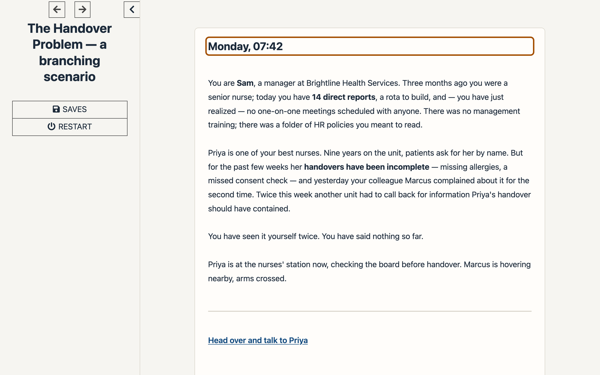

# Should This Be a Course? — a performance consulting case study

One-sentence summary: a stakeholder asks for "feedback training for managers"; this case study shows the analysis that finds the real causes, the blended solution that replaces the 2-hour course, and the measurement plan tied to business outcomes — for instructional designers and L&D consultants who want to see the thinking *before* the course.

**[Live case study](https://iwyusdaz.github.io/should-this-be-a-course/)** · **[Play the branching scenario](https://iwyusdaz.github.io/should-this-be-a-course/05-build/scenario/)** · Role: Sole designer

> **Simulated case, constructed for portfolio purposes.** Brightline Health Services and everyone in it are fictional; all interviews, survey data and documents were built to demonstrate the process. AI-assisted authorship is disclosed below.

**Evaluation status:** Automated accessibility testing and agent-based design reviews are complete. AI-simulated learner and review-panel evaluations are pending. No real learners have tested this yet. See evaluation/METHODS.md.

## The problem

Employers increasingly want learning designers who diagnose before they design — who can tell a learning problem apart from a process, tool or management problem, and who can recommend *less* training when that's what the evidence says. Fewer than a quarter of organizations measure whether training meets organizational goals ([ATD 2026](https://www.td.org/content/atd-blog/highlights-from-atd-s-2026-state-of-the-industry-report)), and "business alignment" now appears in a quarter of senior L&D postings ([Teamed 2026](https://www.teamedforlearning.com/ld-skills-landscape-2026-whats-hot-whats-not/)). Yet almost every ID portfolio shows a finished course — not the judgment that decides whether a course should exist at all.

This project demonstrates that judgment end to end: a realistic, messy request ("build us a 2-hour e-learning course on giving feedback"), a complete discovery, a root-cause analysis, a stakeholder proposal that recommends a blend **and says what it won't build**, one polished branching scenario, and a measurement plan tied to a business metric.

## Audience and context

- **Who it's for:** hiring managers and peers in corporate L&D, learning experience design, and HR/people development.
- **The (fictional) client:** Brightline Health Services — 900 staff, 12 regional clinics, 70 people managers, 35% promoted in the last 18 months. The (fictional) HR Director's request opens the [case study](https://iwyusdaz.github.io/should-this-be-a-course/).
- **The business metric the analysis lands on:** 90-day new-hire turnover, 22% → 15% in 12 months.

## My approach

The full narrative lives on the [case study site](https://iwyusdaz.github.io/should-this-be-a-course/); this is the shape of it:

1. **Intake** — capture the request verbatim and reframe it ([blank template](docs/01-intake/intake-form-template.md) + [completed form](docs/01-intake/intake-form-completed.md)).
2. **Discovery** — [behavioral interview guide](docs/02-discovery/interview-guide.md), 6 [simulated interviews](docs/02-discovery/interview-notes-simulated.md), a [200-row simulated survey](docs/02-discovery/survey-data-simulated.csv) generated by a [seeded script](scripts/generate-survey.mjs) with a fully documented [method](docs/02-discovery/survey-data-readme.md), and a [document review](docs/02-discovery/document-review.md).
3. **Analysis** — [performance gap statement](docs/03-analysis/performance-gap.md), [root-cause analysis with Gilbert's BEM](docs/03-analysis/root-cause-bem.md), a [Mager & Pipe decision flow](docs/03-analysis/mager-pipe-flowchart.md), and the verdict: [is it training?](docs/03-analysis/is-it-training.md) (spoiler: four causes, one narrow skill gap).
4. **Solution design** — [action map](docs/04-solution/action-map.md) (Cathy Moore method), a two-page [stakeholder proposal](docs/04-solution/stakeholder-proposal.md) with a cost comparison, the [solution blueprint](docs/04-solution/solution-blueprint.md), and [what we won't build](docs/04-solution/what-we-wont-build.md).
5. **Build** — a [15-minute branching scenario](https://iwyusdaz.github.io/should-this-be-a-course/05-build/scenario/) (Twine/SugarCube, [Twee source](src/scenario.twee), [design document](docs/05-build/scenario-design.md)), a ["Feedback in 5 minutes" job aid](docs/05-build/job-aid/index.html) (HTML + [tagged PDF](docs/05-build/job-aid/job-aid.pdf)), and a [30-day practice challenge](docs/05-build/30-day-challenge.md).
6. **Measure** — a [measurement plan](docs/06-measure/measurement-plan.md) (leading + lagging indicators, staggered rollout for isolation, named confounds) and a [simulated baseline dashboard](docs/06-measure/baseline-dashboard.md).

## Key design decisions

Each decision, the alternative, and the evidence behind it (full list in [DECISIONS.md](DECISIONS.md)):

1. **Recommend a blend, not the requested 2-hour course** — alternative: build what was asked. *Evidence:* only ~1 in 5 one-on-ones contain structured feedback, but the bigger gaps are structural (31% cadence, spans of 12–18, scorecards with 0% on team development); feedback usefulness differs 1.5 points by meeting structure but only 0.3 by manager tenure. A course cannot edit a form or re-weight a scorecard.
2. **A branching scenario for the one narrow skill gap** — alternative: video + quiz, or nothing. *Evidence:* the skill is a judgment-heavy conversation (opening, pushback, closing); consequences teach decisions better than explanations; 3 decisions × 3 options, converging paths, 3 endings ([scenario design](docs/05-build/scenario-design.md)).
3. **Paths converge, consequences vary** — alternative: a fully branching tree (27 endings). *Evidence:* maintainability and focus on the three key decisions; consequence text still varies with choices, so the feedback feels personal.
4. **A job aid instead of memorization** — alternative: teach the feedback model in the course. *Evidence:* the conversation is infrequent and stressful; external support reduces cognitive load in the room, and the scenario's debrief ties the two together.
5. **Leading + lagging indicators with a staggered rollout** — alternative: completion rates only. *Evidence:* completion says nothing about behavior; cadence, pulse and turnover each test a different link in the causal chain, and wave 1 vs wave 2 clinics give a comparison group.

## Evidence and evaluation

**What was measured (automated, done):**

- The locked baseline the whole case hangs together on — **31%** of managers at a fortnightly-or-better one-on-one cadence, **2.4/5** staff pulse score on useful feedback, **22%** 90-day turnover — is produced exactly by the seeded survey generator and re-verified by `scripts/consistency-check.mjs` across intake, CSV, analysis, dashboard and measurement plan.
- Scripted Playwright tests of the scenario — keyboard-only playthrough, all three ending paths with step counts, focus management (`:passagedisplay` → passage heading), 320px reflow / 400%-zoom equivalent (WCAG-EM), no timed choices, zero page errors. **11/11 passing** ([results](evaluation/scenario-test-results.json), [report](docs/06-measure/usability-test-report.md)).
- axe-core audits of the compiled scenario and job aid — **0 critical/serious violations** (0 total).
- `ariaSnapshot()` accessibility-tree captures committed as screen-reader-output evidence (Guidepup/VoiceOver automation is not functional on this machine's macOS version — **no VoiceOver testing is claimed**; a manual protocol is provided).

**What is pending (pipelines built, keys required):**

- AI-simulated learner runs (4 personas × 2 prior-knowledge levels × ≥2 models) with a **>75% same-choice revision flag** — `npm run eval:pending` ([method](evaluation/METHODS.md)).
- Multi-model agent review panel (3 reviewer roles, rubric agreement + Cohen's κ) — same command.
- Reviewer cognitive walkthrough + heuristic evaluation (review form ready in `evaluation/human-protocol/`).

**What this evidence can and cannot show.** It *can* show: analysis rigor (every cause traces to cited simulated evidence), that the scenario's flows, keyboard support, focus behavior and reflow actually work, and that the accessibility claims match machine-checked evidence. It *cannot* show: real learner experience, learning gains, behavior change, or turnover impact — the data is simulated and nothing was deployed. No real learners have tested this. Every AI-simulated or agent-produced output is labeled by method, never presented as human.

**What changed because of testing:** 4 documented revisions (focus safety net, debrief table → lists for 320px, sidebar contrast, link-markup fix) — each found by a scripted check and re-verified; ledger in the [usability test report](docs/06-measure/usability-test-report.md).

## Accessibility

Designed against WCAG 2.1 AA and tested, not assumed:

- **Scenario:** playable by keyboard alone (verified by scripted Tab/Enter playthrough); focus moves to each new passage heading for screen readers (verified); no timed choices; reflows at 320px / 400% zoom without horizontal scrolling (verified, WCAG-EM method); ≥4.5:1 text contrast; visible focus indicators; respects `prefers-reduced-motion`; `ariaSnapshot` captures committed in `evaluation/aria-snapshot/`.
- **Site:** one `<h1>` per page with logical heading order, `lang` attributes, alt text carrying each chart's takeaway plus a full data table beside every chart, text summary under every Mermaid diagram (Mermaid SVGs aren't reliably announced), Just the Docs theme (v0.12.0, pinned) with search.
- **Documents:** the job aid ships as semantic HTML and a **tagged PDF**.
- **Known limits, stated:** no VoiceOver/manual screen-reader testing has been performed (protocol provided for a human run); no testing with users of assistive technology; simulated personas were never used to stand in for disabled users.
- **Tooling:** axe-core 4.11.1, Playwright 1.57.0 scripted checks, Lighthouse 13 (spot checks).

## AI-assisted authorship (disclosure)

This project was built with AI assistance, and the split is disclosed so the work can be judged honestly:

- **Built by an AI coding agent** (analysis artifacts, scenario, site, tests, pipelines), working from a design brief and locked case facts. All simulated "evidence" (interviews, survey data, documents) was **constructed by that agent for portfolio purposes** and is labeled as such — nothing describes a real organization.
- **Reviewed by automation** (scripted tests, axe audits, seeded-data verification) as described above; four revisions were made because of those checks.
- **What remains human:** the design judgment encoded in the brief, the decision to publish, and — pending — the reviewer walkthrough and human usability sessions. Agent/AI evaluation is labeled by method everywhere and never presented as human or expert feedback.
- **Reproducibility:** the survey CSV regenerates byte-identically from its seed (`node scripts/generate-survey.mjs --verify`); scenario builds are scripted; every pipeline supports `--dry-run`.

## What I'd do differently / next steps

- **Ship a playable-but-smaller scenario sooner.** Getting the focus/keyboard behavior right took several test-fix cycles; earlier scripted testing would have caught the SugarCube quirks (no `:passagedisplay` on first display, quote parsing) before the CSS work.
- **Add a calendar-audit artifact.** Discovery asserts that one-on-ones aren't scheduled; a simulated calendar extract would make that cause even harder to argue with.
- **Run the pending evaluations** (reviewer walkthrough, simulated learner runs, review panel) and the human protocol with 3–5 real participants.
- **Extend the scenario** with a second character thread (Marcus) once the core loop is validated.

## Tools used

Twego 2.1.1 + SugarCube 2.37.3 (scenario), Just the Docs v0.12.0 (site), Mermaid 11 (diagrams), Playwright 1.57.0 (scripted tests, screenshots, tagged PDF), axe-core 4.11.1 (audits), Lighthouse 13 (spot checks), Node.js (data generation + pipelines), GitHub Pages (hosting), gitleaks (secret scanning).

## License and attribution

- **Learning content** (case study, scenario script, templates, evaluation protocols): [CC BY 4.0](LICENSE) — use it, adapt it, attribute it.
- **Code** (scripts, scenario HTML/CSS/JS, job aid HTML/CSS): [MIT](LICENSE-CODE). Third-party software (SugarCube, jQuery, Just the Docs, Mermaid) keeps its own license — see [ATTRIBUTION.md](ATTRIBUTION.md).
- All fictional content and simulated data are labeled; [Email] · [LinkedIn] placeholders belong to the portfolio owner.
