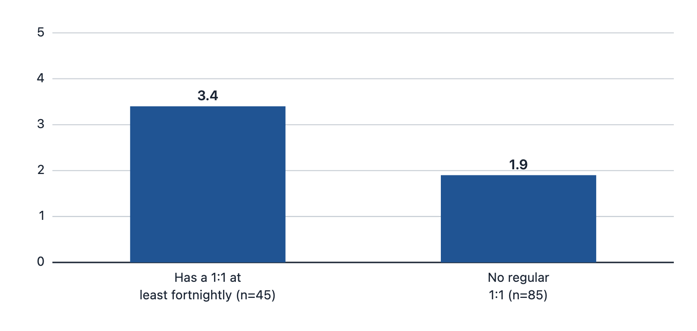
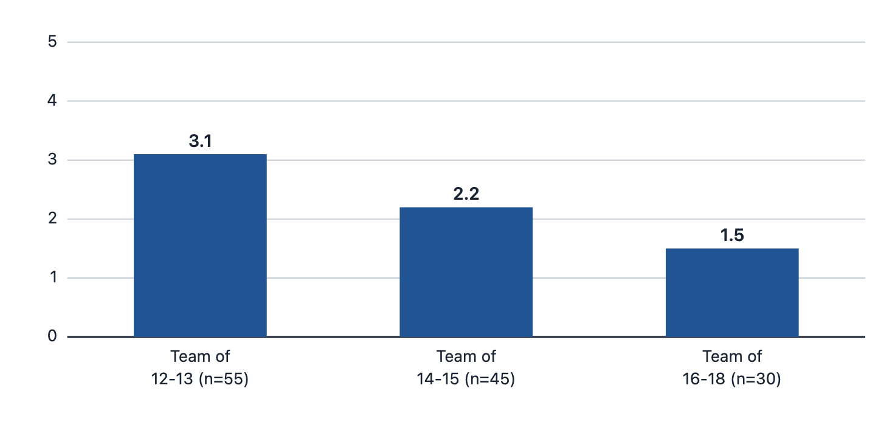
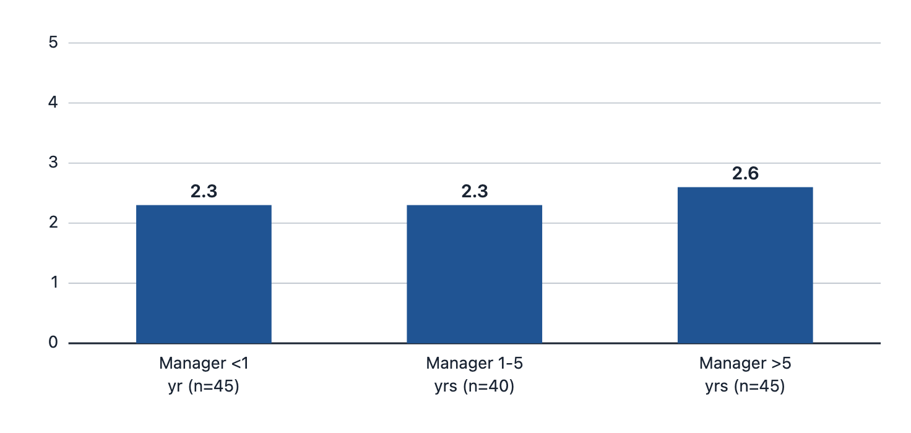
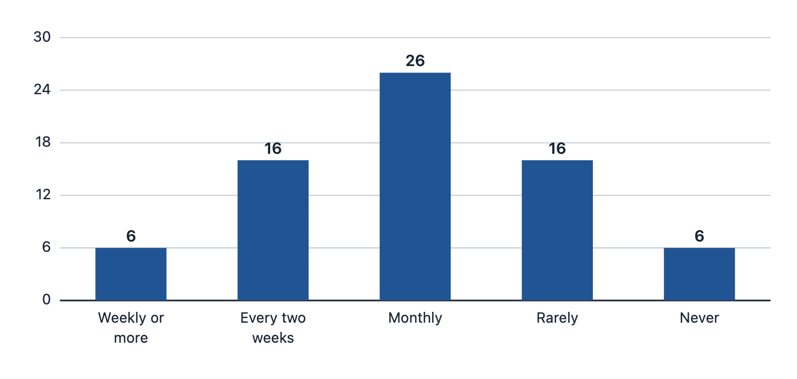

# Survey analysis — what the pulse survey shows

> **Simulated data constructed for portfolio purposes.** Brightline Health Services is fictional. The survey file (`survey-data-simulated.csv`, n = 200) was generated by a seeded script with designed patterns — see the [survey data README](survey-data-readme.html) for the full generation method and column dictionary. The analysis below demonstrates how the discovery evidence was read; the correlations are designed, not discovered, and are disclosed as such.

**Instrument reminder.** Staff answered four Likert items (1–5). The key item — *"I received useful feedback in the last two weeks"* — is the **pulse baseline (2.4/5)** that the [measurement plan](../06-measure/measurement-plan.html) tracks quarterly. Managers self-reported their one-on-one cadence and the share of those meetings containing structured feedback.

## Finding 1: Feedback usefulness tracks meeting structure, not manager experience

Staff with a one-on-one at least every two weeks rate feedback usefulness **3.4/5**; staff without one rate it **1.9/5** — a gap of 1.5 points.

| Group | n | Mean usefulness (/5) |
|---|---|---|
| Has a 1:1 at least fortnightly | 45 | 3.4 |
| No regular 1:1 | 85 | 1.9 |
| **All staff** | **130** | **2.4** |

## Finding 2: The larger the span, the lower the usefulness

Usefulness falls monotonically with team size — from 3.1/5 on teams of 12–13 to 1.5/5 on teams of 16–18.

| Team size band | n | Mean usefulness (/5) |
|---|---|---|
| 12–13 reports | 55 | 3.1 |
| 14–15 reports | 45 | 2.2 |
| 16–18 reports | 30 | 1.5 |

## Finding 3: Manager tenure barely matters

If the problem were "inexperienced managers", usefulness would rise sharply with manager tenure. It does not — the spread across tenure bands is 0.3 points, against 1.5 points for meeting structure.

| Manager tenure band | n | Mean usefulness (/5) |
|---|---|---|
| < 1 yr (expansion cohort) | 45 | 2.3 |
| 1–5 yrs | 40 | 2.3 |
| > 5 yrs | 45 | 2.6 |

This is the finding that redirects the whole engagement: **"train the new managers" would miss most of the problem.** The manager-side data agrees — new managers are *slightly more* likely than veterans to report a fortnightly-or-better cadence (8 of 25, 32%) than managers over 5 years (7 of 25, 28%).

## Finding 4: Only 31% of managers hold one-on-ones at least fortnightly

| Self-reported cadence | Managers | % of 70 |
|---|---|---|
| Weekly or more | 6 | 9% |
| Every two weeks | 16 | 23% |
| Monthly | 26 | 37% |
| Rarely | 16 | 23% |
| Never | 6 | 9% |
| **Fortnightly or better** | **22** | **31%** |

And the meetings that do happen are thin: managers report that only about **1 in 5 one-on-ones (mean 20%)** include structured feedback — a specific behavior, its impact, and an agreed next step. Meeting *more* without changing the content is not the fix.

## Finding 5 (the one that doesn't fit): Cedar Point meets constantly and still scores worst

Cedar Point's staff report the most frequent one-on-ones in the company (mean 4.3/5) and the **lowest** feedback usefulness (1.5/5 vs 2.5/5 elsewhere). Its managers meet weekly — and report almost no structured-feedback content in those meetings. HR's business partner flagged the same anomaly in interviews.

| Clinic | n | Mean 1:1 frequency (/5) | Mean usefulness (/5) |
|---|---|---|---|
| Cedar Point | 12 | 4.3 | 1.5 |
| All other clinics | 118 | 2.3 | 2.5 |

**Why it matters:** it kills the tempting simplification "just make managers meet more." The intervention has to shape the *content* of one-on-ones (template, structured feedback), not only the frequency. This is why the solution pairs the cadence fix with the job aid and the scenario.

## Interpretation and limits

**Reading:** the four findings triangulate with the [interviews](interview-notes-simulated.html) and [document review](document-review.html): feedback at Brightline fails mainly for **environmental and process reasons** (no scheduled one-on-ones, spans of 12–18, a ratings-only review form), with a narrower **skill** gap (structuring a feedback conversation) and a **consequence** gap (scorecards pay for throughput only).

**Limits (stated plainly):**
- All data is **simulated**, constructed for portfolio purposes; no real organization is described.
- The survey is a **cross-sectional snapshot** — the associations above are correlations. In the fiction they would justify a controlled pilot (see the staggered-rollout design in the [measurement plan](../06-measure/measurement-plan.html)), not conclusions.
- n = 200 with cluster sampling by clinic; clinic-level comparisons (like Cedar Point) rest on small n.
- Self-reported cadence was not audited against calendars for the full sample (the discovery calendar audit sampled one clinic; see the [completed intake](../01-intake/intake-form-completed.html)).

**Where this goes next:** [the performance gap statement](../03-analysis/performance-gap.html) and the [root-cause analysis](../03-analysis/root-cause-bem.html).
