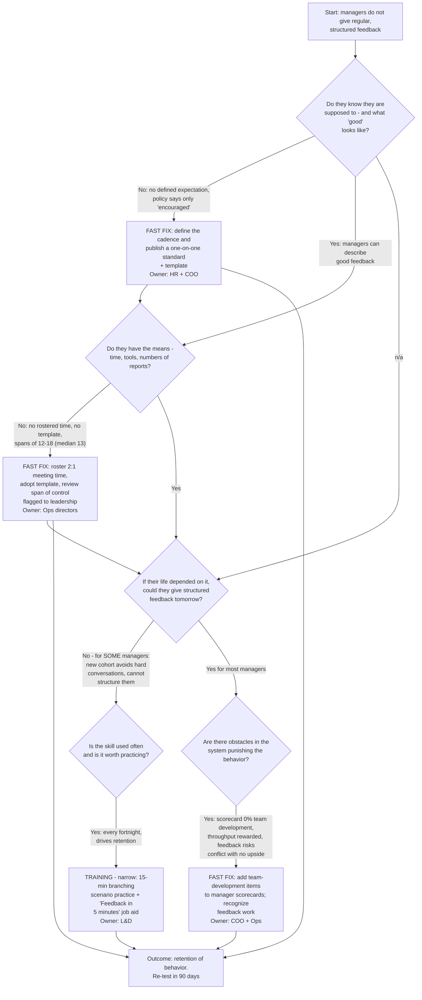

# The Mager & Pipe decision flow applied to Brightline

Mager & Pipe's *Analyzing Performance Problems* gives a sequence of questions for any performance gap: fix the environment first, test whether it's really a skill deficit ("could they do it if their life depended on it?"), and only then train — choosing between "can't do" remediations. The flowchart below runs Brightline's four causes through that procedure.

### Text summary of the diagram (for screen readers and plain reading)

1. **Start:** managers do not give regular, structured feedback.
2. **Do they know they're supposed to, and what good looks like?** Partly no: there is no defined expectation (the policy only "encourages" one-on-ones). Fast fix: define the cadence, publish a one-on-one standard and template. Owner: HR + COO.
3. **Do they have the means — time, tools, team size that permits it?** No: no rostered time, no template, spans of 12–18. Fast fix: roster the meeting time, adopt the template, and flag a span-of-control review to leadership. Owner: operations directors.
4. **If their life depended on it, could they give structured feedback tomorrow?** For most managers, yes — they can describe good feedback; they don't have the structure to do it in. For *some* (concentrated in the new-manager cohort), no: they avoid hard conversations and cannot structure one. That subset passes the skill test into training.
5. **Is the skill used often and worth practicing?** Yes — every fortnight, and it is tied to the retention result. So training is warranted, but *narrow*: a 15-minute branching scenario for practice plus a "Feedback in 5 minutes" job aid on the job. Owner: L&D.
6. **Are there obstacles in the system punishing the behavior?** Yes: scorecards carry 0% weight on team development while throughput is heavily rewarded. Fast fix: add team-development items to scorecards and recognize feedback work. Owner: COO + operations.
7. **Outcome:** the fixes reinforce each other; retention of the behavior is re-tested at 90 days (see the [measurement plan](../06-measure/measurement-plan.html)).

## Why this ordering matters

Mager & Pipe's discipline is that **training is the last check, not the first reflex**. Applied here, three of the four paths end in "fast fixes" (environment, process, incentives) and only one narrow path reaches training — and even that path pairs practice with a job aid rather than a course. Running the flow *after* the [BEM analysis](root-cause-bem.html) cross-checks the same evidence with an independent procedure; both agree.

> Diagram note: Mermaid diagrams are rendered from the text description above; if you use a screen reader, the numbered summary is the accessible version. The flow structure paraphrases Mager & Pipe's published model — see [ATTRIBUTION](https://github.com/iwyusdaz/should-this-be-a-course/blob/main/ATTRIBUTION.md).
