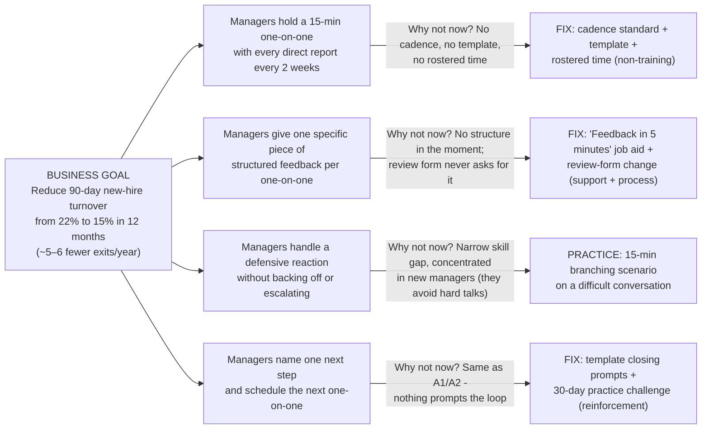

# Action map (Cathy Moore method)

> **Simulated case.** Brightline Health Services and all names and figures are fictional — constructed for portfolio purposes.

Action mapping starts from the **business goal**, asks what people must **do** for the goal to happen, then — for each action — asks *why they aren't doing it already* before allowing any training into the design. Every practice activity must serve an action; no activity exists to "cover content".

## The map

### Text summary of the diagram

- **Business goal:** reduce 90-day new-hire turnover from 22% to 15% in 12 months.
- **Action 1** — managers hold a 15-minute one-on-one with every direct report every two weeks. *Why not now:* no cadence, no template, no rostered time. **Fix (non-training):** cadence standard + template + rostered time.
- **Action 2** — managers give one specific piece of structured feedback per one-on-one. *Why not now:* no structure in the moment; the annual form never asks for it. **Fix:** "Feedback in 5 minutes" job aid + review-form change.
- **Action 3** — managers handle a defensive reaction without backing off or escalating. *Why not now:* a narrow skill gap, concentrated in newer managers who avoid hard conversations. **Fix (the training slice):** a 15-minute branching scenario practiced on a realistic conversation.
- **Action 4** — managers agree one next step and schedule the next one-on-one. *Why not now:* nothing prompts the loop to close. **Fix:** template closing prompts + the 30-day practice challenge for reinforcement.

## The action-to-solution table

| What managers must DO | Why aren't they doing it? (evidence) | The fix | Practice activity (only where training is warranted) |
|---|---|---|---|
| Hold a 15-min one-on-one every two weeks | Environment: not scheduled, no time, spans of 12–18 (survey F4, org chart) | Cadence standard + template + rostered time (non-training) | None — doing it IS the practice, with the template |
| Give one specific piece of structured feedback per one-on-one | Process + support: no structure in the moment (~1 in 5 of 1:1s — survey F4) | Job aid on hand during the meeting; 2 qualitative questions added to annual form | Scenario decision point 1 and 3 rehearse "be specific" |
| Handle defensiveness without backing down or escalating | Skill: new managers avoid hard conversations (interview M1; narrow gap) | Job aid "if they get defensive" prompts | **Scenario decision point 2** — the core practice, with consequences |
| Close the loop: one next step + next 1:1 booked | Same environment gap; nothing prompts the loop | Template closing prompts; 30-day challenge with peer check-ins | Scenario endings show the cost of not closing the loop |

**What the map deliberately leaves out:** anything managers must *know* that they already know (interviews: they can describe good feedback), general communication theory, personality-style modules, and "active listening" content with no decision to practice. See [what we won't build](what-we-wont-build.html).
