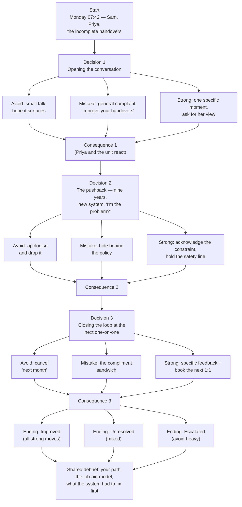

# Scenario design — "The Handover Problem"

**Play it:** [docs/05-build/scenario/index.html](scenario/index.html) (opens in a new tab) · **Toolchain:** written as Twee 3 source ([`src/scenario.twee`](https://github.com/iwyusdaz/should-this-be-a-course/blob/main/src/scenario.twee)), compiled with Tweego 2.1.1, story format **SugarCube 2.37.3** (pinned). Rebuild with `npm run build:scenario`.

## The story

The learner is **Sam**, a manager promoted three months ago at Brightline Health Services, with 14 direct reports and no one-on-one habit. Sam's skilled direct report **Priya** — nine years on the unit — has started filing incomplete handovers, and a colleague has complained twice. The scenario covers the two weeks in which Sam must open a hard conversation, survive the pushback, and close the loop.

It is deliberately the *narrow* skill gap from the [root-cause analysis](../03-analysis/root-cause-bem.html): structuring and holding one difficult feedback conversation. The scenario also shows the environment Sam works in — broken sheets, shift timing, an unset one-on-one standard — so the debrief can point at what skill alone cannot fix.

## Structure

Three decision points, three options each (a strong move, a realistic mistake, an avoidant move), paths that converge after each decision, three endings determined by the pattern of choices, and a shared debrief.

### Text summary of the diagram

Start → Decision 1 (three options) → consequence scene → Decision 2 (three options) → consequence scene → Decision 3 (three options) → consequence scene → one of three endings (Improved / Unresolved / Escalated, chosen by how many strong moves the player made) → a shared debrief that names the player's actual path, links the feedback model to the [job aid](job-aid/index.html), and separates what skill fixes from what the *system* had to fix first.

## Where each option came from

Every option is a behavior the [discovery interviews](../02-discovery/interview-notes-simulated.html) actually heard:

| Decision | Strong move | Realistic mistake | Avoidant move | Source in the analysis |
|---|---|---|---|---|
| 1. Opening | Name one specific, recent behavior; ask for their view first | "Your handovers need to improve" — a general complaint with nothing to act on | Small talk and waiting for the problem to surface | M1's public, vague comment to Jordan; the M2 contradiction (feedback "constantly", scores 2.1) |
| 2. Pushback | Acknowledge the real constraint, hold the safety line, ask what would help | "It's mandatory, comply" — the policy as a shield | Apologise and withdraw the concern | M2's policy reflex; HR1's point that the policy "never defined regular"; S1's "you hear about it second-hand" |
| 3. Closing | One specific feedback + agreed next step + booked next 1:1 | The compliment sandwich | Cancel — "next month" | The template's closing prompts; S2's cancelled check-in; the calendar audit |

The three "realistic mistakes" were written to be *attractive* — each is defensible in the moment ("being direct", "staying calm", "not making it weird", "she's exhausted"). No option announces itself as correct (final quality check: no obviously right option).

## Consequence feedback, not "Correct!"

Priya and the unit react to what Sam did — the handovers change (or don't), Marcus complains (or stops), the exit interviews get written (or don't). The endings name the business metric the case is built on: the Escalated ending runs through an incident report and Priya's resignation, citing "no feedback / didn't feel supported" — the same coding as the simulated exit-interview data in the [measurement plan](../06-measure/measurement-plan.html). The debrief shows the player their own three choices and links each decision to the strong/mistake/avoidant table above. No scores, no points, no color cues.

## Endings logic

Each strong move adds 1; each realistic mistake adds 0; each avoidant move subtracts 1. All three strong moves → **Improved**; mistake-heavy and mixed paths (score 0–2) → **Unresolved**; avoidant-heavy paths (score ≤ −1) → **Escalated**. There is no hidden "perfect play" requirement — two strong moves plus one mistake lands in Unresolved, which reads as honest: one brilliant opening does not carry a conversation that gets abandoned later. Avoidance is what escalates: withdrawing a patient-safety concern or repeatedly cancelling one-on-ones is what turns a performance problem into an incident report and a resignation.

## Accessibility decisions (details verified by tests)

- **Keyboard:** choices are real links (`<a>`); the whole scenario is playable with Tab + Enter alone. No timed choices, no drag, no hover-only content.
- **Focus:** after every passage change, focus moves programmatically to the new passage's heading (`:passagedisplay` handler; the heading receives `tabindex="-1"`), so screen readers announce where the story just went (WCAG 2.4.3). The sidebar keeps the page's single `<h1>` (story title); passage titles are `<h2>` so heading order stays logical.
- **Contrast & size:** body text ≥ 17px, 4.5:1+ contrast for text (13.9:1 body, 8.6:1 links), focus ring 4.6:1 — verified by axe.
- **Reflow:** no fixed widths; tested at 320 px viewport and at 400% zoom (no horizontal scrolling).
- **Reduced motion:** transitions are neutralized under `prefers-reduced-motion`; there are no auto-playing animations.
- **Screen reader evidence:** Playwright `ariaSnapshot()` captures are committed in `evaluation/aria-snapshot/` (Guidepup/VoiceOver automation is not functional on the build machine's macOS; the manual VoiceOver check protocol is in `evaluation/human-protocol/manual-voiceover-check.md`).

## Build notes

- Source: [`src/scenario.twee`](https://github.com/iwyusdaz/should-this-be-a-course/blob/main/src/scenario.twee) (Twee 3; IFID `1FA829CE-6491-4C29-ACC7-F54D08C18A5B`). It can be imported into the Twine desktop editor and round-tripped.
- `npm run build:scenario` compiles with Tweego and applies two post-compile steps, both visible in `scripts/build-scenario.mjs`: it adds `lang="en"` to the `<html>` element (SugarCube's template omits it) and verifies the format version, focus handler and passages landed.
- The debrief links (`../job-aid/index.html`, `../../03-analysis/...`) are relative, so they work on GitHub Pages under the site's base path.
